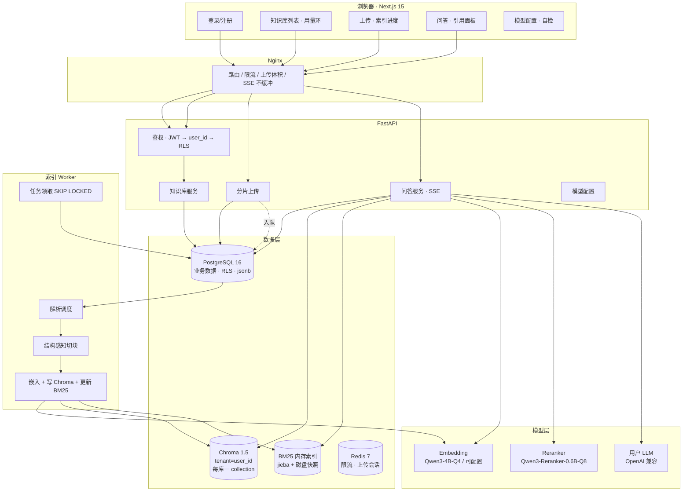
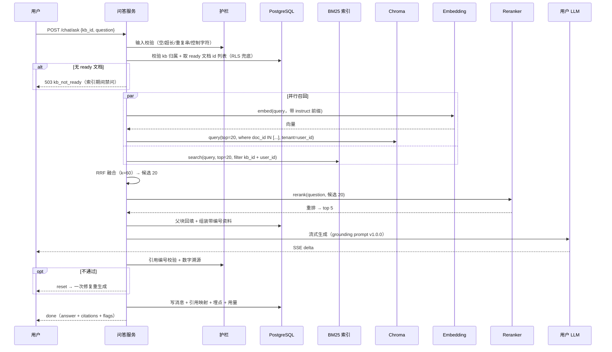

# RAG 知识库问答系统 — 架构方案

> 版本：v3.3.0 · 2026-10-17 · 状态：**共识已达成，可作为开发依据**
>
> 本文档是**施工规格**，不是教程。技术选型的解释性说明另见 `docs/knowledge/技术说明.md`。
>
> 一句话定位：**面向中文文档、可本地一键运行的 RAG 知识库问答系统，核心卖点是「可观测的解析质量」与「答案可追溯」。**

## 目录

| 章 | 内容 | 谁看 |
|---|---|---|
| 1 | 项目定位与架构判断 | 所有人 |
| 2 | 需求五要素 | 所有人 |
| 3 | 总体架构与时序 | 研发 |
| 4 | 技术栈与版本 | 研发 |
| 5 | 核心设计决策 D1-D13 | **研发必读** |
| 6 | 解析策略与数据管道 | 研发（重点） |
| 7 | 数据模型 | 研发 |
| 8 | API 契约 | 前后端 |
| 9 | 错误处理与降级 | 研发 |
| 10 | 可观测性 | 研发 |
| 11 | 评测体系 | 研发 |
| 12 | 部署 | 运维 |
| 13 | 开发计划与目录结构 | **研发必读** |
| 14 | 明确不做 | 所有人（划边界） |
| 15 | 风险清单 | 所有人 |
| 16 | 待核实清单 | 研发 |
| 17 | 不可逆决策与反悔成本 | 所有人 |

---


## 1. 项目定位与架构判断

### 1.1 定位

| 项 | 内容 |
|---|---|
| 目的 | 简历作品展示（开源形式，MIT） |
| 验收标准 | ①陌生人 5 分钟跑起来 ②每个决策能讲出「为什么」和「代价」 ③有可量化效果数据 |
| 非目标 | 生产级高可用、多机扩展、商业化计费、企业级合规审计 |
| **最强约束** | **凡增加「组件数量」却不增加「可讲述的技术深度」的东西，一律不做** |

> 判断尺举例：不上 Elasticsearch（多一个组件，收益只是「更标准的 BM25」），
> 但上 jieba + rank_bm25（不增加组件，却拿到真正的中文词粒度召回）。

### 1.2 这不是 Agent，是固定工作流

```
鉴权 → 输入校验 → 配额/预算检查 → 双路召回 → RRF 融合 → Rerank
     → 上下文装配 → 生成 → 引用校验 →（可选一次修复）→ 输出
```

控制流可完全穷举，没有一步需要模型自行决定「下一步查什么工具、循环几次」。

| 模式 | 采用 | 理由 |
|---|---|---|
| Autonomous Loop | ❌ | 无动态工具调用需求 |
| Orchestrator-Workers | ❌ | 子任务固定，无需模型拆解 |
| Routing | ❌ | 只有一种查询形态 |
| Parallelization | ⚠️ 仅召回阶段 | BM25 与向量并行，是提速不是投票 |
| Evaluator-Optimizer | ⚠️ 只用 1 次 | 引用校验失败后允许一次修复 |
| **Prompt Chaining** | ✅ 主形态 | 步骤固定、每步可独立测试 |

唯一的「自主」成分是引用校验后的单次修复，硬约束 `MAX_REPAIR_ATTEMPTS = 1`。

---


## 2. 需求锚定（五要素）

| 维度 | 内容 |
|---|---|
| **目标** | 多租户 RAG 知识库问答站：多库管理 + 单库问答 + 答案可追溯到原文 |
| **输入** | 注册登录 → 建库（≤5）→ 上传文件（≤1GB/库，禁音视频）→ 选中单库提问 |
| **输出** | SSE 流式回答 + 逐句引用（文件名 / 页码 / 工作表行号 / 章节路径）；无依据时明确说"未找到" |
| **成功指标** | 引用合规率 100%、表格行召回率 ≥90%、编号类查询准确率 ≥95%、首 token P95 ≤2s、问答成功率 ≥90% |
| **硬约束** | 5 库/人、1GB/库、禁音视频、数据隔离、登录从简、单机可跑、8GB 显卡可开发 |
| **已知风险** | ①"任意格式"实际是"可解析子集" ②"不捏造"只能降概率 ③量化模型检索指标低于 fp16 |

---

---


## 3. 总体架构



### 3.1 问答链路（最终形态）



---

---


## 4. 技术栈与版本

| 层 | 组件 | 版本 | 许可证 |
|---|---|---|---|
| 后端 | Python | 3.11 | PSF |
| | FastAPI | 0.143.3 | MIT |
| | SQLAlchemy | 2.1.5 | MIT |
| | psycopg | 3.3.6 | LGPL-3.0（动态链接，不传染） |
| | uvicorn | 0.54.0 | BSD-3 |
| | pydantic / pydantic-settings | 2.14.1 / 2.16.0 | MIT |
| 数据库 | PostgreSQL | 16 | PostgreSQL License |
| | Redis | 7 | BSD |
| 向量库 | **ChromaDB** | **1.5.9** | **Apache-2.0** |
| 关键词 | **jieba** | 0.42.1 | MIT |
| | **rank_bm25** | 0.2.2 | Apache-2.0 |
| 编排 | **langchain-core** | 1.6.12 | MIT |
| | langchain-openai | 1.7.2 | MIT |
| | langchain-chroma | `[待核实: 查 PyPI 最新版本号]` | MIT |
| 解析 | pypdf | 6.21.0 | BSD |
| | pdfplumber | 0.11.10 | MIT |
| | python-docx | 1.2.0 | MIT |
| | python-pptx | 1.0.2 | MIT |
| | openpyxl | 3.1.5 | MIT |
| | markdown-it-py | 4.2.0 | MIT |
| | beautifulsoup4 / lxml | 4.15.0 / 6.1.3 | MIT / BSD |
| | charset-normalizer | 3.5.2 | MIT |
| 安全 | PyJWT | 2.15.1 | MIT |
| | argon2-cffi | 25.1.0 | MIT |
| | cryptography | 50.0.2 | Apache-2.0 / BSD |
| 观测 | structlog | 26.1.0 | Apache-2.0 |
| 前端 | Next.js | 15 | MIT |
| 模型服务 | LM Studio（开发）/ llama-cpp-python（分发） | — | — |

**模型权重**（不入代码仓库，随镜像或首次下载）：
- `Qwen3-Embedding-4B-GGUF Q4_K_M` — Apache-2.0，磁盘 2.5 GB
- `Qwen3-Reranker-0.6B Q8` — Apache-2.0

---

---


## 5. 核心设计决策

### D1 · 检索：双路召回 → RRF → Rerank 【已定】

| 阶段 | 实现 | 参数 |
|---|---|---|
| 向量召回 | Chroma `query()`，余弦距离 | top 20 |
| 关键词召回 | jieba 分词 → `BM25Okapi.get_scores()` | top 20 |
| 融合 | RRF，`score = Σ 1/(60 + rank)` | 候选 20 |
| 重排 | Qwen3-Reranker-0.6B 逐对打分 | **取 top 5** |

**v3.1 调整**：重排后从 top 8 改为 **top 5**。理由：8 条资料让生成模型注意力分散，实测常见现象是"用了第 1、2 条，其余忽略"，反而浪费上下文；5 条更聚焦，且上下文从约 6000 token 降到约 4000，为一次修复重生成留出空间，首 token 也更快。

### D2 · BM25 索引的持久化与一致性 【已定】

| 问题 | 方案 |
|---|---|
| 存哪 | 进程内存（`BM25Okapi`）+ 磁盘快照（pickle，按 kb 分文件） |
| 何时写 | 索引任务完成一个文档 → 增量 add 到内存 + 异步落盘（debounce 5s） |
| 何时读 | 启动时**懒加载**（访问某 kb 才载入），避免全量加载拖慢启动 |
| 删除一致性 | 以 PG `chunks` 为准；内存维护 `{chunk_id: 下标}` 反查表，删除打墓碑，墓碑占比 ≥20% 时重建 |
| 兜底 | 与 Chroma 一样是派生索引，可从 PG 全量重建（`make reindex`） |

**为什么用墓碑而非立即重建**：`BM25Okapi` 的 IDF 与平均文档长度是全局统计量，单条删除会让统计量失准；打墓碑 + 查询时过滤 + 阈值触发重建，是精度与成本的折中。

### D3 · Chroma 多租户隔离 【已定】

- `tenant = user_id`，`database = "kb"`
- collection 命名 `kb_{kb_id}`（Chroma 1.x 要求 3-512 字符、`[a-zA-Z0-9._-]`、首尾字母数字）
- 距离度量 `configuration={"hnsw": {"space": "cosine"}}`
- **写入一律 `upsert`**（`add` 遇重复 ID 是静默丢弃，隐蔽 bug 源）

**三层隔离**：
1. 业务数据：PG `FORCE ROW LEVEL SECURITY` + `NOBYPASSRLS` 角色
2. 向量数据：Chroma `tenant=user_id`（结构约束，优于 where 过滤）
3. 检索兜底：查询前从 PG 取"该用户该库 ready 文档 id 列表"，Chroma 强制带 `where={"doc_id": {"$in": [...]}}`

> 第 3 层是必需的：Chroma 的 tenant 由客户端传入，服务端不鉴权；
> 叠加 PG 侧权威文档列表后，"即使 tenant 传错，结果也只能是该用户文档集合的子集"。

---


### D4 · 索引原子性 【已定】

**问题**：索引写到一半失败，Chroma 留下半成品向量 → 检索能命中"未完成"的文档。

**方案**：`documents.status` 是唯一检索入口。
- 开始时 `status='embedding'`，全部写入成功才置 `'ready'`
- 检索时 PG 只返回 `status='ready'` 的 doc_id 并用于过滤 Chroma

半成品天然不可见，**无需"临时 collection + 原子切换"**那套复杂机制。

### D5 · LangChain 只用 L1 组件层 【已定】

| 用 | 不用 |
|---|---|
| `OpenAIEmbeddings`（连本地 GGUF 服务） | `create_retrieval_chain` |
| `ChatOpenAI`（连用户模型） | `ConversationalRetrievalChain` |
| `Chroma`（vectorstore 封装） | LCEL 管道编排 |

**理由**：本项目最有价值的代码是"RRF 融合 + 引用校验 + 一次修复 + 降级"，LangChain 无现成实现；用框架编排会把它们拆散到多个 hook，降低可读性与可讲述性。

### D6 · 模型部署 【已定】

| 环境 | 方案 |
|---|---|
| 开发 | LM Studio 加载 `Qwen3-Embedding-4B-Q4_K_M`，暴露 `http://127.0.0.1:1234/v1` |
| 分发 | `scripts/start-embedding.py`，用 llama-cpp-python 加载同一 GGUF，暴露相同协议 |
| 契约 | 只认 `EMBED_BASE_URL` + `EMBED_MODEL` + `EMBED_DIM`，实现无关 |

**显存预算（RTX 4060 8GB，实测）**：

| 用途 | 占用 |
|---|---|
| 系统 / 桌面基础 | 约 1.5 GB |
| Embedding 4B-Q4（权重 2.5GB + KV） | 约 3.0-3.2 GB |
| Reranker 0.6B-Q8 | 约 0.8-1.0 GB |
| **合计** | **约 5.3-5.7 GB / 8.19 GB** |

余量约 2.5GB，可行；**不建议同时开大型游戏或视频剪辑**。

#### D6-b · 模型服务的启动时序（v3.2 补充）

**结论：每次提问都必须有 embedding 服务在跑；但大部分开发工作不需要它。**

| 场景 | 需要 LM Studio | 原因 |
|---|---|---|
| 上传文档后的索引过程 | ✅ 必须 | 切块后要向量化 |
| **每一次提问** | ✅ 必须 | 问题要先转成向量才能检索（**这是最容易被忽略的一点**） |
| 写代码 / 跑单元测试 | ❌ 不需要 | 解析、切块、引用校验都是纯函数；embedder 在测试中注入假实现 |
| 启动 API / 前端 / 看质量看板 | ❌ 不需要 | 启动过程不调模型 |
| 重跑 P8 之后的评测集 | ✅ 需要 | 评测要真实作答 |

**四条工程约束（由这个时序推导出来）**：

1. **Embedder 必须是接口**，不能是硬编码的 HTTP 调用 —— 否则单测全部依赖外部服务
   ```python
   class Embedder(Protocol):
       async def embed_documents(self, texts: list[str]) -> list[list[float]]: ...
       async def embed_query(self, question: str) -> list[float]: ...

   class FakeEmbedder:          # 测试用：返回确定性向量
       async def embed_documents(self, texts): return [[0.1] * 2560 for _ in texts]
       async def embed_query(self, q):         return [0.1] * 2560
   ```

2. **索引任务在模型不可达时转 `waiting_model`，不标失败** —— 否则模型晚起 5 分钟，用户重传的文件全部变成 `failed`

3. **问答在模型不可达时立即报错并给出可操作提示**（「向量服务未启动，请先打开 LM Studio」），不要静默降级成空结果

4. **README 必须写明启动顺序**：
   ```
   1. 打开 LM Studio，加载模型，启动本地服务（端口 1234）
   2. docker compose up -d
   3. make dev
   ```
   顺序颠倒会导致索引任务卡在 `waiting_model`、问答全部报错 —— 这是新手最常踩的坑。

### D7 · 模型可替换 + 换模型检测 【已定】

- 配置项 `EMBED_BASE_URL` / `EMBED_MODEL` / `EMBED_DIM`
- `documents.embed_model` 记录生成向量的模型标识
- 启动校验：当前配置与库中记录不一致 → 拒绝服务并提示 `make reindex`
- 理由：换模型必换向量空间，不校验会产生"检索结果全是噪声但系统不报错"的隐性故障

### D8 · 配额规则（产品定死，不做运营后台）【已定】

| 规则 | 值 |
|---|---|
| 每用户知识库上限 | 5 |
| 每库容量上限 | 1 GiB |
| 单文件上限 | 200 MB |
| 每库文件数上限 | 1000 |
| 用户日问答次数 | 200 |
| 单用户并发问答 | 3 |
| 单库并发索引任务 | 2 |

全部写在 `app/core/config.py` 常量，前端直接展示。

### D8-b · 命名规则与删除策略（v3.2 新增）【已定】

**知识库命名**：

| 规则 | 实现 |
|---|---|
| 空白处理 | 入库前 `strip()`，首尾空格不计入名称 |
| 大小写 | **敏感**（`Financial` 与 `financial` 视为两个库） |
| 长度 | 1-100 字符（strip 后计） |
| 唯一性 | `UNIQUE(user_id, name)` 在 strip 后的值上生效 |
| 冲突提示 | 「已有同名知识库，请换一个名称」 |

> 为什么大小写敏感：中文用户不会用大小写区分名称，但英文用户会。
> 折叠大小写会造成"我明明建了 Financial，它说重名"的困惑，成本大于收益。

**删除策略：物理删除 + 前端强确认**

```
用户点"删除知识库"
  ↓
弹窗要求手动输入知识库名称
  ↓
输入一致才启用"确认删除"按钮（危险红）
  ↓
后端 DELETE → 级联删除 documents / chunks / Chroma collection / BM25 索引
```

**明确不做软删除/回收站**，理由：

1. 软删除会给所有查询多加一个 `deleted_at IS NULL` 条件，**漏写一处就是已删数据泄露**——这正是选 Chroma 后最该避免的那类 bug
2. 强确认交互能挡住 90% 的误操作，成本几乎为零
3. 这是演示项目，数据可重建

**必须在 README 声明的风险**：删除不可恢复，且**没有备份机制**（见 §15）。

### D9 · 索引任务队列 【已定】

DB 任务表 + `FOR UPDATE SKIP LOCKED`，不引入 Celery/Kafka。
- 最多 3 次尝试，退避 1/5/15 分钟 ±25% 抖动
- 单任务墙钟上限 30 分钟
- worker 启动回收停滞 30 分钟以上的 `running`

### D10 · 上传 【已定】

- 5MB 分片，支持乱序与续传
- 先预扣配额：`UPDATE ... WHERE used_bytes + size <= quota_bytes`，原子不超卖
- 秒传：同库 sha256 命中直接复用
- 合并需读入内存 → 单文件 200MB，峰值约 200MB × 并发 2 = 400MB，4GB 机器可承受

### D11 · 引用校验与修复 【已定】

三道：
1. **无召回 → 不调 LLM**，"未找到"
2. **强制逐句 `[n]` 引用**（prompt 规则 A-H）
3. **机械校验**：编号越界 + 数字/编号溯源 → 失败一次修复 → 仍失败则剔除越界编号并打标

**技术边界（诚实写入 README）**：只能查"编号对不对""数字在不在"，**查不出"引用了正确编号但内容张冠李戴"**。语义级忠实度校验需额外 NLI 调用，一期不做。

### D12 · 登录（v3.1 调整）【已定】

| 项 | 规则 |
|---|---|
| 账号标识 | **用户名**：3-20 字符，`[a-zA-Z0-9_]`，唯一 |
| 密码长度 | **6-12 位** |
| 密码字符 | **仅数字 + 英文字母大小写**，且**必须至少包含一个字母和一个数字** |
| 哈希 | argon2id（`time_cost=3, memory_cost=64MB, parallelism=2`） |
| 令牌 | access 15min（内存）+ refresh 7d（httpOnly cookie） |
| **登录限流** | **每用户名 5 次/分钟 + 每 IP 5 次/分钟**，双维度独立计数 |
| 失败提示 | 统一返回"用户名或密码错误"（防账号枚举，不区分"用户不存在"与"密码错"） |

**必须写进 README 的安全声明**：6 位纯数字密码只有 100 万种组合，现代显卡离线爆破是秒级的。本项目的密码策略是"演示项目从简"，**迁移到生产环境必须改为 ≥12 位 + 增加邮箱验证 + 增加登录失败锁定**。限流不是锦上添花，是这套弱密码策略下唯一能挡住在线爆破的手段。

**明确缺失**：无邮箱验证、无找回密码、无二次验证。

### D13 · 多轮对话与查询改写（v3.1 新增）【已定】

**问题**：用户问"那它的上限呢"，检索系统只看到这句孤立的话，向量召回会失败。

**方案：按需查询改写（Conditional Query Rewrite）**

```
检测指代词（它/这个/那个/上述/前者/后者/该/此/这几个/刚才说的…）
  ├── 命中 → 调用户配置的 LLM，把问题改写成完整问句 → 用改写后的问题做三路召回
  └── 未命中 → 直接用原问题召回，零额外调用
```

| 项 | 决策 |
|---|---|
| 改写模型 | **用户配置的 LLM**（不额外加载本地模型，不挤占 8GB 显存） |
| 触发条件 | 正则命中指代词 **且** 会话轮次 > 1（首轮无历史可指代） |
| 超时 | 5s，超时则降级用原问题（不阻塞主线） |
| 失败处理 | 改写失败 → 用原问题 + 标 `degraded=no_rewrite` |
| 额外延迟 | 命中时 +300-800ms；未命中时 0 |

**为什么不做无条件改写**：每轮都改写会额外消耗用户 token 且增加延迟，而"每轮都有指代词"是不成立的假设。用一行正则筛掉 70% 的调用，是"感知不到延迟"与"多轮体验好"的平衡点。

**改写 Prompt（独立版本管理，`rewrite_v1.0.0.md`）**：
```
把用户的最新问题改写成一个不依赖上下文的完整问句。
规则：
1. 只补全指代与省略，不改变问题意图
2. 不引入对话中没有的信息
3. 输出改写后的问题本身，不要加任何解释
4. 若最新问题本身已完整，原样输出

对话历史：
{history}

最新问题：{question}
```

---

---


## 6. 解析策略矩阵（P0，项目质量地基）

| 格式 | 主策略 | 关键处理 | 已知局限 |
|---|---|---|---|
| **PDF（文字版）** | pypdf `extract_text()` + pdfplumber 表格 | ①标题启发式（行长≤40、无句读结尾、匹配编号模式）②去页眉页脚（同文本在顶/底重复 ≥40% 页）③表格 `lines` 策略抽取并剔除重叠文本 ④页码变化强制切父块 | 标题识别约 80-85%（低于 PyMuPDF 的 95%）；多栏顺序可能乱 |
| **PDF（扫描件）** | 字符密度检测 | 每页可提取字符 < 50 → `no_text_layer`，提示不支持 OCR | 一期不做 OCR |
| **DOCX** | python-docx **按 body 顺序遍历** | ①不能用 `paragraphs`+`tables` 分别取（表格会跑到文末）②`Heading N`/`标题 N` 双样式名 ③合并单元格按 `cell._tc` 去重 | 脚注、批注、文本框不取 |
| **PPTX** | python-pptx 按 slide | ①**必读 notes_slide** ②按 `shape.top` 排序还原阅读顺序 ③表格与组合图形内文本 ④页码 = slide 序号 | 纯图片 PPT 无法处理 |
| **XLSX** | openpyxl 只读 | ①**行级切块**：表头块 + 每行一子块，表头重复前置 ②空/重复表头自动命名 ③空行分隔的逻辑表拆开 ④日期规范化 ⑤超 5000 行截断标记 | 公式无缓存值时丢数 |
| **CSV** | 分隔符嗅探 | 同 XLSX | 脏 CSV 会错列 |
| **Markdown** | markdown-it-py token 流 | 不用正则（嵌套列表/围栏代码必错） | 内嵌裸 HTML 不解析 |
| **TXT/LOG** | charset-normalizer + 空行分段 | GBK 自动识别 | 无结构信息 |
| **HTML** | BeautifulSoup + lxml | 剔除 script/style/nav/footer；按 h1-h6/p/li/pre/table 文档序 | 仅静态 HTML |

**不支持但给可操作提示**：`.doc/.xls/.ppt`（"请另存为新格式"）、音视频（"本系统只索引文本"）、`.zip`（"请解压后上传"）。

### 6.0 显式数据管道（v3.1 新增，D1 落地）

RAG 的索引流水线本质就是 ETL。本项目把它做成**显式的、可观测的、可分阶段重跑的管道**，而不是塞在 worker 里的黑盒。这是本项目的第二个加分项。

```
Extract          Transform                    Load
─────────        ──────────────────────       ──────────────────
parse(file)  →   chunk(parsed)            →   embed(chunks)
   ↓                  ↓                          ↓
ParsedDoc        ChunkSet                   EmbeddingBatch
   ↓                  ↓                          ↓
parsed.json      chunks.json                vectors.bin
   ↓                  ↓                          ↓
每个阶段落盘中间产物，可单独重跑
```

**四个核心能力**：

| 能力 | 实现 | 价值 |
|---|---|---|
| **阶段契约** | `ParsedDoc` → `ChunkSet` → `EmbeddingBatch` 三个 dataclass，输入输出强类型 | 每阶段可独立单测 |
| **单阶段重跑** | `make reprocess DOC_ID=xxx STAGE=chunk` 从中间产物续跑，不重下载/重解析 | 调切块参数时不用等 PDF 重解析 |
| **质量报告** | 每文档产出 `quality_report.json`（见下） | 能定位"是解析丢了内容还是切块切坏了" |
| **数据血缘** | chunk → parent → document → 原始页码/行号，全链路可追溯 | 引用点击能落到原文 |

**质量报告结构**（`documents.parse_meta` 存一份，同时落 JSON 文件）：

```json
{
  "document_id": "uuid",
  "filename": "2024年度报告.pdf",
  "ext": "pdf",
  "stages": {
    "parse": {
      "parser": "pypdf+pdfplumber",
      "duration_ms": 3421,
      "page_count": 128,
      "char_count": 87432,
      "block_count": 412,
      "table_count": 17,
      "heading_count": 34,
      "header_footer_removed": 256,
      "warnings": ["第 45 页表格未检测到边框，已降级为段落"]
    },
    "chunk": {
      "duration_ms": 812,
      "parent_count": 58,
      "child_count": 214,
      "table_row_chunks": 96,
      "dropped_count": 12,
      "dropped_reasons": {
        "too_short": 9,
        "duplicate": 3
      },
      "avg_tokens": 387,
      "max_tokens": 512,
      "min_tokens": 42
    },
    "embed": {
      "duration_ms": 18400,
      "model": "qwen3-embedding-4b-q4km",
      "dim": 2560,
      "batch_count": 14,
      "token_usage": 82914
    }
  },
  "health": {
    "score": 0.86,
    "issues": ["12 个块因过短被丢弃", "1 处表格降级"]
  }
}
```

**健康分算法**（用于质量看板的排序与告警）：

```
health.score = 1 - penalty
penalty = 0.4 × (dropped_count / total_blocks)      -- 丢块占比
        + 0.3 × (1 if has_warnings else 0)          -- 解析告警
        + 0.3 × (1 if char_per_page < 200 else 0)   -- 疑似扫描件/解析失败
```

低于 0.7 的文档在看板上标红，提示用户检查。

**前端质量看板**（`/kb/[id]/quality`）：

| 区域 | 内容 |
|---|---|
| 顶部概览 | 文档总数 / 健康文档数 / 平均健康分 / 总块数 |
| 文档列表 | 文件名 / 页数 / 块数 / 健康分（色条）/ 告警摘要 |
| 单文档详情 | 三阶段耗时瀑布、丢块原因分布、告警列表、可点"重跑本阶段" |
| 全库问题 | "3 份文档疑似扫描件"、"12 个块因过短丢弃" 等聚合提示 |

**明确不做（L3 通用 ETL 框架）**：不支持自定义管道、插件式 Parser 注册表、配置化转换规则、DAG 编排。理由是那会让你花两周造框架而 RAG 主线没跑通。

### 6.1 表格行级切块（性价比最高的单一改动）

整表当一个 chunk 时，"Q3 华东区营收多少"会命中一大段混杂文本，模型极易把"华南"的数认成"华东"。
行级切块让一行成为可独立检索、独立引用的最小单元，引用精确到"工作表 + 行号"。

### 6.2 标题可手动修正（弥补 pypdf 精度不足）

解析后把标题结构存入 `documents.parse_meta`，前端提供"结构预览 + 树形修正"面板。
用户修正后触发该文档重切块。**这是 pypdf 路线下必须提供的兜底入口。**

### 6.3 数据生命周期（v3.2 新增）

**这张表决定了 P3/P4 要写哪些清理任务。不定清楚，代码里就会漏。**

| 数据 | 存储位置 | 保留期 | 清理触发 | 实现 |
|---|---|---|---|---|
| **原文件** | 本地卷 `data/files/` | 永久，直到用户删除 | 用户手动删除知识库/文档 | 删除时同步删物理文件 |
| **切块文本** | PG `chunks` | 跟文档同生命周期 | 文档删除（CASCADE） | 外键级联 |
| **向量** | Chroma collection | 跟文档同生命周期 | 文档删除 / 知识库删除 | 删文档时按 `doc_id` 过滤删；删库时 `delete_collection` |
| **BM25 内存索引** | 进程内存 + 磁盘快照 | 跟文档同生命周期 | 文档删除打墓碑，占比 ≥20% 重建 | 见 D2 |
| **管道中间产物** | `data/staging/{doc_id}/` | **7 天** | 定时任务扫描 mtime > 7 天的目录 | 保留给"单阶段重跑"，过期即删 |
| **对话消息** | PG `messages` | 永久 | 用户删知识库时 CASCADE | 不做清理 |
| **问答埋点** | PG `query_logs` | 永久 | 无 | **不做清理**（见下） |
| **上传临时分片** | `data/uploads/` | 24 小时 | 上传会话过期 + 定时扫描 | Redis TTL 到期的同时清理文件 |
| **孤儿向量** | Chroma | — | 兜底任务：比对 PG `documents` 与实际 collection 内容 | `make reindex` 时全量重建，作为兜底 |

**关于 `query_logs` 不清理的说明**：

按 5 个用户、每人每天 50 次提问估算，一年约 9 万条，占用 < 100 MB。**demo 场景下根本到不了需要清理的量级，加清理任务反而增加出错可能。**

但这是已知限制，必须写进 README：

```
已知限制：query_logs / messages 只增不减。长期运行请自行归档或清理。
```

**清理任务清单**（P3 实现）：

| 任务 | 频率 | 动作 |
|---|---|---|
| `cleanup_staging` | 每天一次 | 删 `data/staging/` 下 mtime > 7 天的目录 |
| `cleanup_uploads` | 每小时 | 删 `data/uploads/` 下超过 24h 的分片 |
| 其余 | — | 不做 |

---

---


## 7. 数据模型

```sql
-- PG：业务数据（RLS 保护）
users(id, email, password_hash, is_active, created_at)

knowledge_bases(id, user_id, name, description, status,
                quota_bytes DEFAULT 1GiB, used_bytes, doc_count, chunk_count,
                created_at, updated_at)  UNIQUE(user_id, name)

documents(id, kb_id, user_id, filename, mime, ext, size_bytes, sha256,
          storage_key, status, error_code, error_detail,
          parse_meta jsonb,          -- 标题结构、页数、表格数
          chunk_count,
          embed_model varchar(128),  -- 生成向量的模型标识
          created_at)
  UNIQUE(kb_id, sha256)

chunks(id, document_id, kb_id, user_id, parent_id, level, seq, chunk_type,
       heading_path, page_from, page_to, sheet_name, row_range, text, token_count)
  -- 注意：不再有 chunk_embeddings 表（向量在 Chroma）

conversations(id, kb_id, user_id, title, created_at)
messages(id, conversation_id, user_id, role, content, citations jsonb,
         trace_id, model, prompt_tokens, completion_tokens, latency_ms, flags jsonb)

ingest_jobs(id, document_id, user_id, status, stage, attempts, last_error, run_after)
user_llm_configs(user_id PK, base_url, api_key_cipher, model, extra,
                 last_check_ok, last_check_at, last_check_error)
usage_daily(user_id, day, ask_count, prompt_tokens, completion_tokens)
query_logs(id, user_id, kb_id, trace_id, retrieve_hits, rerank_used, top_score,
           context_tokens, prompt_tokens, completion_tokens, latency_ms,
           first_token_ms, citation_valid, repair_attempted, grounded,
           status, prompt_version, embed_model)
```

### 状态机

```
documents.status:       pending → parsing → chunking → embedding → ready
                                                          ↘ failed（可重试则回 queued）
knowledge_bases.status: indexing → ready / error
ingest_jobs.status:     queued → running → done | retrying(≤3) → failed
```

### 三份存储的一致性模型

```
PostgreSQL（唯一真相）
    ├── Chroma（派生：向量）
    └── BM25 内存索引（派生：词项统计）
两者均可从 PG 全量重建：make reindex
```

---

---


## 8. API 契约

| 方法 | 路径 | 说明 |
|---|---|---|
| POST | `/api/v1/auth/register` | 注册 |
| POST | `/api/v1/auth/login` | 登录 |
| POST | `/api/v1/auth/refresh` | 刷新（轮换 refresh） |
| POST | `/api/v1/auth/logout` | 登出 |
| GET/POST | `/api/v1/knowledge-bases` | 列表 / 创建（超 5 个 → 409 `kb_limit_reached`） |
| GET/DELETE | `/api/v1/knowledge-bases/{id}` | 详情 / 删除（前端强二次确认） |
| GET | `/api/v1/knowledge-bases/{id}/documents` | 文件列表 + `indexing` 计数 |
| DELETE | `/api/v1/documents/{id}` | 删文件，实时退还配额 |
| GET | `/api/v1/documents/{id}/structure` | 标题结构（供手动修正） |
| PUT | `/api/v1/documents/{id}/structure` | 保存修正后的标题，触发重切块 |
| GET | `/api/v1/upload/supported-formats` | 支持/拒绝格式清单 |
| POST | `/api/v1/upload/init` | 预扣配额 → 返回分片参数 |
| PUT | `/api/v1/upload/{id}/part/{n}` | 上传分片 |
| POST | `/api/v1/upload/{id}/complete` | 合并 → 秒传判定 → 入队 |
| POST | `/api/v1/upload/{id}/abort` | 取消，退还配额 |
| GET/PUT | `/api/v1/llm/config` | 用户 LLM 配置（key 只回显末 4 位） |
| POST | `/api/v1/llm/check` | 连通自检 |
| GET/PUT | `/api/v1/embedding/config` | 向量模型配置 |
| POST | `/api/v1/embedding/check` | 向量服务自检 |
| POST | `/api/v1/chat/ask` | **SSE 流式问答** |
| GET | `/api/v1/conversations?kb_id=` | 会话列表 |
| GET | `/api/v1/conversations/{id}/messages` | 历史消息 |
| GET | `/health` / `/health/deps` | 存活 / 依赖 |

### SSE 事件

| type | 载荷 | 前端动作 |
|---|---|---|
| `meta` | conversation_id, trace_id | 记录会话 |
| `delta` | text | 追加 |
| `notice` | message | 顶部提示 |
| `degraded` | reason, message | 黄色警示条 |
| `reset` | reason | **清空气泡，准备重放** |
| `error` | code, message, trace_id | 红色错误 |
| `done` | answer, citations[], flags, stats | 渲染引用卡片 |

---

---


## 9. 错误处理与降级

| 节点 | 失败 | 分类 | 处理 | 降级 |
|---|---|---|---|---|
| 上传 | 超配额 | 终止 | 409 + 当前用量 | — |
| 上传 | 音视频 | 终止 | 415 + 支持清单 | — |
| 解析 | 扫描件 | 需人工 | `no_text_layer` + 提示 | — |
| 解析 | 库异常 | 可重试 ×2 | 退避 1s/4s | 标 `parse_failed` |
| 嵌入 | 服务 5xx | 可重试 ×3 | 指数退避 + 抖动 | 任务 `waiting_model` |
| 嵌入 | 服务不可达 | 可重试 | 同上 | 任务 `waiting_model`，前端显示"等待向量服务" |
| 嵌入 | 维度不符 | 终止 | 明确报错 | — |
| 检索 | 向量通道失败 | 可重试 ×2 | — | **仅 BM25**，标 `degraded=bm25_only` |
| 检索 | BM25 未就绪 | 终止 | 重建索引 | 仅向量 |
| Rerank | 超时（3s） | 可重试 ×1 | — | **跳过重排用 RRF 顺序**，标 `degraded=no_rerank` |
| 改写 | 超时（5s） | 终止 | — | 用原问题检索，标 `degraded=no_rewrite` |
| 改写 | LLM 报错 | 终止 | — | 同上 |
| 鉴权 | 密码校验失败 | 终止 | 统一"用户名或密码错误" | 计数 +1，超限 429 |
| 鉴权 | 用户名/IP 超限 | 终止 | 429 + `Retry-After` | — |
| 生成 | 401/402/404 | 终止 | 402 引导改配置 | — |
| 生成 | 429 | 可重试 ×2 | 2s/6s 退避 | 保留已输出部分 |
| 生成 | 首 token 超时（20s） | 可重试 ×1 | — | 503 + trace_id |
| 生成 | 引用越界 | 需修复 | 1 次修复 | 剔除越界编号 + 打标 |

**每次降级必须打 warn 日志 + 计数 + 告知用户**，静默降级比报错更危险。

---

---


## 10. 可观测性

| span | 必埋字段 |
|---|---|
| `http_request` | trace_id, method, path, status, latency_ms |
| `retrieval.vector` | kb_id, top_k, hit_count, latency_ms |
| `retrieval.bm25` | kb_id, top_k, hit_count, docs_in_index, latency_ms |
| `retrieval.fuse` | in_a, in_b, out, latency_ms |
| `rerank` | candidates, kept, model, latency_ms |
| `embedder.post` | batch_size, tokens, status_code, latency_ms |
| `llm.chat` | model, prompt_tokens, completion_tokens, first_token_ms, finish_reason, attempt |
| `pipeline.repair` | triggered |

**四大指标**：问答成功率、首 token P95、单次 token 成本、降级触发次数。
**业务指标**：引用合规率、编号类查询命中率、表格行召回率。

---

---


## 11. 评测体系

### 11.1 索引层

| 指标 | 通过线 |
|---|---|
| 文本还原率 | ≥0.95 |
| 表格结构准确率 | ≥0.90 |
| 标题层级准确率 | ≥0.80（pypdf 路线下调） |
| 无效 chunk 率 | ≤3% |
| **表格行召回率** | **≥0.90** |

### 11.2 检索层

| 指标 | 用途 |
|---|---|
| recall@20 | 粗召回是否够 |
| **recall@5** | 重排收益（v3.1 从 @8 改为 @5） |
| MRR | 正确文档排第几 |
| **编号类查询命中率** | 量化 BM25 通道价值（对比"仅向量"） |
| **改写触发率与改写准确率** | 量化 D13 按需改写的效果（触发是否合理、改写是否保真） |

### 11.3 问答层（≥24 条）

| 类别 | 条数 | 覆盖 |
|---|---|---|
| normal | 12 | 事实、数值、表格取数、跨段归纳、多文档对比 |
| boundary | 7 | 空输入、超长、纯符号、库为空、索引中、问库外、矛盾前提 |
| adversarial | 5 | 提示注入、诱导编造、越权问他人库、重复串轰炸、要求忽略知识库 |

**通过线**：L1 确定性断言 100%、L2 规则评分 ≥95%、L3 judge ≥4.0/5、对抗用例 100%。

### 11.4 特殊实验（简历加分项，必做）

| 实验 | 产出 |
|---|---|
| Q4 量化 vs fp16 的 recall 对比 | "量化导致 recall 下降 X%" |
| 加/不加 BM25 通道 | "编号类查询从 A% → B%" |
| 加/不加 Rerank | "recall@5 提升 Y%" |
| **按需改写 vs 不改写** | "多轮追问可答率从 A% → B%，额外调用率仅 C%" |
| **质量报告的实用价值** | 举例定位一次真实的数据问题（如"某 PDF 丢了 40 个块，原因是表格降级") |

---

---


## 12. 部署

### 12.1 开发（本地 Windows）

```
1. docker compose -f docker-compose.dev.yml up -d   # PG + Redis + Chroma
2. LM Studio 加载 Qwen3-Embedding-4B-Q4_K_M，开启本地服务（端口 1234）
3. make db-init
4. make dev                                          # API + Worker + 前端
```

### 12.2 分发（一键体验）

```
docker compose up
首次自动：
 - 拉取 embedding/reranker GGUF（约 3.5GB，可挂载本地文件跳过）
 - 建表 + RLS
 - 导入示例知识库（已完成索引 + 一段预设对话）
```

### 12.3 云服务器（2vCPU / 4GiB / 无 GPU）

**明确不部署模型服务。**
- 可跑：PG + Redis + Chroma + API + 前端（约 1.7GB）
- 不可跑：任何 embedding 模型

**结论**：线上只放**静态展示页**（架构图、截图、录屏、GitHub 链接），不提供在线试用。
理由：为一个"能访问的链接"牺牲架构正确性不划算；模型回调本地机器的方案在面试当天会坑人。

---

---


## 13. 开发计划

### 13.0 项目目录结构（v3.2 新增）

```
kb-qa/
├── LICENSE                          # MIT
├── THIRD_PARTY_NOTICES.md           # Chroma / LangChain / Qwen3-Embedding 许可声明
├── README.md                        # 运行说明 + 决策叙事 + 已知限制
├── Makefile                         # make help 为入口
├── .env.example                     # 全部配置项 + 说明，不含真实密钥
├── docker-compose.yml               # 分发用（含模型服务）
├── docker-compose.dev.yml           # 开发用（只起 PG/Redis/Chroma）
│
├── backend/
│   ├── pyproject.toml
│   ├── alembic.ini
│   ├── migrations/
│   │   └── versions/
│   ├── tests/
│   │   ├── parsers/                 # 每个格式一个测试文件
│   │   ├── chunker/
│   │   ├── citation/
│   │   └── api/
│   └── app/
│       ├── main.py                  # FastAPI 装配
│       ├── core/                    # 跨模块基础设施
│       │   ├── config.py            # 全部常量与配额
│       │   ├── security.py          # argon2 / JWT / Fernet
│       │   ├── logging.py           # structlog + trace_id + 脱敏
│       │   ├── telemetry.py         # span 埋点
│       │   └── errors.py            # 异常分类（retryable / needs_human / fatal）
│       ├── db/
│       │   ├── session.py           # 连接池 + RLS 会话
│       │   └── models.py            # ORM
│       ├── schemas/                 # Pydantic 出入参
│       ├── api/
│       │   ├── deps.py              # 认证依赖、限流
│       │   ├── auth.py
│       │   ├── knowledge_base.py
│       │   ├── document.py
│       │   ├── upload.py
│       │   ├── chat.py              # SSE
│       │   ├── quality.py           # 质量看板数据
│       │   └── settings.py          # 模型配置
│       ├── services/                # 业务逻辑（不含 HTTP）
│       │   ├── kb_service.py        # 配额、命名、删除
│       │   ├── doc_service.py
│       │   ├── upload_service.py    # 分片、秒传
│       │   └── quality_service.py   # 质量报告聚合
│       ├── rag/
│       │   ├── parsers/             # P2：9 种格式，每格式一文件
│       │   │   ├── base.py          # ParsedDoc / Block 契约
│       │   │   ├── pdf.py  docx.py  pptx.py  xlsx.py
│       │   │   └── md.py   txt.py   html.py  csv.py
│       │   ├── chunker.py           # P4：父子块
│       │   ├── embedder.py          # P4
│       │   ├── retriever.py         # P6：双路召回 + RRF
│       │   ├── reranker.py          # P6
│       │   ├── rewriter.py          # P6：按需指代改写
│       │   ├── citations.py         # P6：引用校验（纯函数，可单测）
│       │   ├── pipeline.py          # P6：问答工作流
│       │   └── prompts/             # 版本化 prompt（v1.0.0 独立文件）
│       ├── index/                   # 三份派生索引的读写
│       │   ├── chroma_store.py
│       │   └── bm25_store.py
│       └── workers/
│           ├── ingest_worker.py     # P4：SKIP LOCKED
│           └── cleanup.py           # §6.3 的两个清理任务
│
├── frontend/                        # Next.js 15 App Router
│   ├── package.json
│   ├── app/
│   │   ├── (auth)/login/page.tsx
│   │   ├── kb/page.tsx              # 库列表
│   │   ├── kb/[id]/page.tsx         # 库详情 + 上传
│   │   ├── kb/[id]/chat/page.tsx    # 问答
│   │   ├── kb/[id]/quality/page.tsx # 质量看板
│   │   └── settings/page.tsx        # 模型配置
│   ├── components/
│   └── lib/api.ts                   # SSE 客户端
│
├── docs/
│   ├── 02-架构方案-v3.md
│   ├── diagrams/
│   │   ├── product-flow.svg
│   │   └── README.md
│   └── samples/                     # 示例知识库文档
│
├── eval/
│   ├── cases/                       # 评测集 jsonl
│   └── run_eval.py
│
├── scripts/
│   ├── dev.sh                       # 一键起开发环境
│   ├── seed.py                      # 导入示例知识库
│   ├── start-embedding.sh           # llama-cpp-python 起模型服务
│   └── check-diagram.py
│
└── data/                            # 运行时数据（.gitignore）
    ├── files/                       # 原文件
    ├── staging/                     # 管道中间产物（7 天清理）
    ├── uploads/                     # 分片临时区（24h 清理）
    └── bm25/                        # BM25 索引快照
```

**三条目录规则**：

1. **`services/` 不放 HTTP 相关代码**——路由只做参数校验与转发，业务逻辑全在 service，这样才能被 worker 复用
2. **`rag/citations.py` 是纯函数**——不依赖 DB、不依赖模型，可脱离环境单测
3. **`index/` 独立于 `rag/`**——检索算法（rag/retriever）不关心向量存在哪，存储细节封装在 index/

### 13.1 竖切片定义（v3.2 新增）

**P1-P9 是横向分层。如果不插入竖切片，前 5 个阶段做完之前连一句话都答不出来。**

原计划的风险：

```
P2 解析层（9 格式）→ P3 管道 → P4 切块嵌入 → P5 API → P6 检索问答
                                    ↑
                          到这里才能看到第一个答案
                          如果架构有问题，前 5 阶段全部要返工
```

**竖切片插在 P2 之后**（即"解析层"与"数据管道"之间空出半周）：

| 项 | 内容 |
|---|---|
| **范围** | 只支持 **TXT** 一种格式，不做表格、不做标题层次 |
| **链路** | 手动放文件到 `data/files/` → 切块 → 向量化 → 写 Chroma → 命令行提问 → 打印答案 + 引用 |
| **不做** | 不做 UI、不做上传、不做 BM25、不做 Rerank、不做质量报告 |
| **目的** | 用最短路径验证四件事：<br>① 模型服务能连上<br>② Chroma 读写正常<br>③ 提示词能让模型说人话<br>④ 引用编号能被正确解析 |
| **验收** | 命令行输入一个问题，能返回带 `[1]` 引用的答案，且引用能对上原文 |
| **预留** | 2-3 天 |

**为什么值得多花这 3 天**：

这四件事任何一件不通，后面写的解析层、管道、API 全部白做。**而它们的组合失效只会在端到端时才暴露。**

```
插竖切片后的顺序：
P2 解析层 → [竖切片：TXT 跑通最短链路] → P3 管道 → P4 切块嵌入 → P5 API → P6 检索问答
                    ↑
            此时只有 TXT，但链路已通
            后面所有工作都是「加厚」，不是「试错」
```

### 13.2 阶段表

| 阶段 | 内容 | 验收标准 |
|---|---|---|
| **P0** | 仓库骨架（按 §13.0 建目录）、`LICENSE`(MIT)、`THIRD_PARTY_NOTICES.md`、compose、`.env.example`、`Makefile` | `make help` 可用；目录结构与 §13.0 一致 |
| **P1** | PG DDL + RLS + 角色 + 迁移 | 建表成功；两个用户验证隔离生效 |
| **P2** | **解析层**（9 格式 + 单测 + 结构预览数据） | 对样例文件输出解析报告 |
| **★ 竖切片** | **TXT 端到端跑通**（见 §13.1） | 命令行能答出一句带引用的答案 |
| **P3** | **显式数据管道**（阶段契约 + 中间产物落盘 + 单阶段重跑 + 质量报告 + 2 个清理任务） | `make reprocess` 可用；产出 quality_report.json；清理任务可手动触发 |
| **P4** | 切块 + 嵌入 + Chroma 写入 + BM25 更新 + Worker | 上传一个文件跑到 `ready` |
| **P5** | 认证（用户名+密码+限流）+ 知识库（含输入库名确认删除）+ 分片上传 API | 接口可跑通，配额正确，爆破被限流挡住 |
| **P6** | 三路检索 + RRF + Rerank + 按需改写 + 问答 + SSE | 端到端能答，多轮追问能答，引用可点开 |
| **P7** | 评测集 + 基线 + 四组对照实验 | 报告 + 通过率 |
| **P8** | 前端五页（含**质量看板**）+ seed + 演示对话 | 一键起，打开即能问，能看质量报告 |
| **P9** | README（含决策叙事、RRF 科普、已知限制）+ 静态展示页 | 陌生人 5 分钟跑通 |

**每个阶段是否需要 LM Studio 在运行**（见 D6-b 的时序规则）：

| 阶段 | 需要模型？ | 具体原因 | 注意 |
|---|---|---|---|
| P0 骨架 | ❌ 不需要 | 只建目录、写配置、装依赖 | — |
| P1 数据库 | ❌ 不需要 | 只跑 DDL 与 RLS 验证 | — |
| P2 解析层 | ❌ 不需要 | 解析是纯函数，输出 `ParsedDoc` | **这是最容易误判的一步**：解析不做向量化 |
| **★ 竖切片** | ✅ **必须** | 要真实向量化 + 检索 + 生成 | **第一次需要开模型**，也是验证模型服务的时机 |
| P3 数据管道 | ⚠️ 分两半 | 契约/落盘/重跑：不需要<br>质量报告的 embed 段统计：需要 | 可先做前一半 |
| **P4 切块与嵌入** | ✅ **必须** | 嵌入是这一步的全部内容 | 开发期常驻 |
| P5 API | ❌ 不需要 | 只做 HTTP 层与配额 | 索引接口会入队，但队列消费在 P4 已完成 |
| **P6 检索问答** | ✅ **必须** | 检索要 embed 问题；生成要调用户 LLM | 除模型外还需要配一个用户 LLM key |
| P7 评测 | ✅ **必须** | 真实跑召回与生成 | 评测期间保持运行 |
| **P8 前端** | ✅ **需要**（联调时） | 上传后要等索引完成才能问 | 若只调 UI 样式可不开 |
| **P9 README** | ✅ **需要**（录屏/截图时） | 要截真实问答界面 | 只写文档可不开 |

**归纳成一句话**：

> **只有「会产生或消费向量」的阶段需要模型。** P0/P1/P2/P5 完全不需要，其余都需要。

**建议的常开区间**：从 **★ 竖切片** 开始到 **P9 结束**，模型基本要一直开着。
中间的 P3/P5 可以关掉，但开关频繁反而容易忘——**实际执行时建议：竖切片之后就一直开着**。


**为什么解析层排在 API 之前**：解析是质量地基，且不依赖外部服务（除样例文件），可独立开发验证；
先做它能最早暴露"某格式根本解析不了"这类致命问题。若先做 API，等发现解析不行时返工面很大。

**为什么 P3（数据管道）要独立成阶段而不是并进 P4**：把"管道契约 + 中间产物 + 质量报告"先立起来，
后续切块和嵌入都是往这个骨架里填肉；若先写 worker 再补管道，等于重写一遍调度逻辑。

**阶段的分支与合并流程**见 [`CONTRIBUTING.md`](../CONTRIBUTING.md)。本文档只管"做什么"，流程规范在那边。

---

## 14. 明确不做（一期范围外）

- 多库联合检索（需求明确"指定一个知识库"）
- 分享 / 协作 / 权限（除用户隔离外）
- 知识库内文件搜索、批量移动
- 对话导出、PDF 引用高亮跳转
- 计费与支付
- 邮件服务（验证、找回密码、通知）
- OCR、图片内文字、公式转 LaTeX（二期）
- 老格式 `.doc/.xls/.ppt` 转码（不装 LibreOffice，给出转存提示）
- 运营后台（配额在代码里定死）
- **自动备份/定时备份**（v3.2 决策）：不做。用户数据只存一份，磁盘损坏即全丢。
  README 必须显著声明：「本项目无备份机制，请勿用于存放不可再生的重要文档」
- **软删除/回收站**（v3.2 决策）：不做。用「输入库名确认」代替，删除即物理删除且不可恢复
- **`query_logs` / `messages` 的自动清理**（v3.2 决策）：不做，只增不减。README 声明为已知限制

---

---


## 15. 风险清单

| 风险 | 概率 | 影响 | 缓解 |
|---|---|---|---|
| Chroma 与 PG 数据不一致 | 中 | 高 | PG 为唯一真相 + 可全量重建 + 检索时用 ready 文档过滤 |
| BM25 内存索引与 PG 不一致 | 中 | 中 | 墓碑机制 + 阈值重建 + `make reindex` |
| Q4 量化导致检索指标下降 | 高 | 中 | 评测集量化对比，结果写进 README |
| pypdf 标题识别准确率不足 | 高 | 中 | 提供手动修正面板；改用编号模式启发式补强 |
| 8GB 显存同时跑 embedding + reranker 时 OOM | 中 | 高 | 降 4B 的上下文长度；reranker 可关闭 |
| 陌生人在自己机器上跑不起来（模型下载慢/无 GPU） | 高 | 高 | 提供"仅 UI 演示"模式 + 详细的 README 前置说明 |
| 中文分词对专业术语切错 | 中 | 中 | jieba 支持加载自定义词典，提供 `dict.txt` 扩展位 |
| **弱密码策略被在线爆破**（v3.1） | 中 | 高 | 双维度限流（用户名 + IP 各 5 次/分）+ argon2id + README 明确声明 |
| **按需改写的正则漏判**（v3.1） | 中 | 低 | 指代词词表可配置；漏判时退化为"用原问题检索"，不会答错只会答不上 |
| **改写引入幻觉**（v3.1） | 中 | 中 | 改写 prompt 明确禁止引入对话之外的信息；改写只看历史不改语义；失败降级用原问题 |
| **质量报告的 health score 是拍脑袋公式**（v3.1） | 高 | 低 | 公式权重写进文档可调；一期只用于排序与提示，不做自动决策 |
| **管道中间产物占磁盘**（v3.1） | 高 | 低 | 中间产物保留 7 天后自动清理；可配置保留策略 |
| **无备份机制，磁盘损坏即全丢**（v3.2） | 中 | **高** | 已确认不做。缓解：README 显著声明 + 原文件目录可手动拷贝 + `make reindex` 可从 PG 重建索引（但 PG 本身挂了就没了） |
| **删除不可恢复**（v3.2） | 中 | 中 | 前端输入库名强确认；README 声明 |
| **模型服务未启动导致索引卡住**（v3.2） | **高**（开发期必遇） | 中 | 任务转 `waiting_model` 而非失败；前端显示"等待向量服务"；README 写明启动顺序 |
| **单测依赖真实模型导致开发体验差**（v3.2） | 中 | 中 | Embedder 做成接口，单测注入假实现（返回固定向量），**测试全程不需要 LM Studio** |

---

---


## 16. 待核实清单

| # | 事项 | 核实方式 |
|---|---|---|
| V1 | `langchain-chroma` 的当前版本号与 API 形态 | 查 PyPI |
| V2 | Qwen3-Embedding-4B 在 Q4_K_M 下的最优上下文长度与 KV cache 占用 | 实测 |
| V3 | Q4 量化相对 fp16 的 recall 下降幅度 | 用评测集实测 |
| V4 | pypdf `extract_text()` 在双栏 PDF 上的阅读顺序质量 | 用样例文件实测 |
| V5 | jieba 对合同/财务报表类术语的切分准确率 | 用样例文本抽样 |
| **V6** | LM Studio / llama.cpp 的 `/v1/embeddings` 是否支持 `dimensions` 参数 | 起服务后实测（决定 A2 的 2560 是否能被截断，当前按不支持处理） |
| **V7** | 4B-Q4 在 2560 维输出下的单条 embedding 延迟 | 实测 100 条计时 |
| **V8** | 按需改写的指代词词表覆盖率 | 用 50 条多轮对话样本抽查 |

---

---


## 17. 不可逆决策与反悔成本

> 改这些决策的代价是「重跑全部索引」或「重写一个模块」。改之前先看这里。

### 17.1 不可逆（改了就回不去，必须一次定对）

| 决策 | 为什么不可逆 |
|---|---|
| **Embedding 模型与维度** | 换模型/换维度 = 全部向量重算，所有文档重新索引 |
| **分块策略（父子块粒度）** | 改粒度 = 全部文档重切块 + 重嵌入，且历史引用定位会失效 |
| 引用的定位粒度（页码/行号） | 改定位方式，历史消息里的引用全部失效 |

### 随时可改的决策（配置项或单模块）

| 决策 | 改动范围 |
|---|---|
| Rerank 开关与模型 | 一个配置项 |
| RRF 的 k 值、各路 top_k | 配置项 |
| prompt 版本 | 换一个 md 文件 |
| 配额数字 | 常量 |
| 前端配色与布局 | 纯前端 |
| 是否启用 BM25 通道 | 配置项（保留代码） |

---

## 附录：相关文档

| 文档 | 内容 |
|---|---|
| `docs/knowledge/技术说明.md` | psycopg / GGUF 服务 / OpenAIEmbeddings 是什么；RRF 原理与示例 |
| `docs/diagrams/product-flow.svg` | 产品架构图 |
| `docs/diagrams/README.md` | 架构图的栅格参数与改图规则 |
| `eval/fixtures/README.md` | 测试素材的组织方式与缺口清单 |
